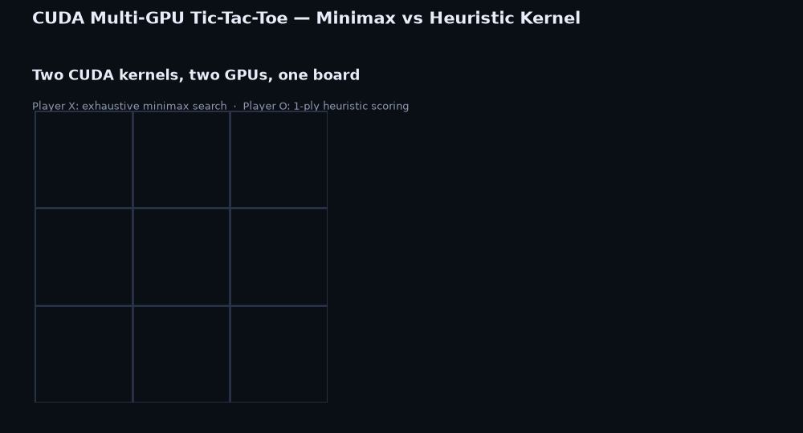

# CUDA Multi-GPU Tic-Tac-Toe

Coursera "CUDA at Scale for the Enterprise" independent project: two CUDA
kernels play tic-tac-toe against each other as competing GPUs, each
deciding its own moves instead of running plain CPU logic behind a
decorative kernel call.

## What this project does and why

Tic-tac-toe was picked over Connect 4 or chess because its whole game tree
(at most 9 plies) is small enough to search exhaustively from one kernel
launch, so the GPU side of the design stays simple and inspectable.

- **Player X — minimax kernel** (`src/minimax_kernel.cu`): one thread per
  empty cell, each recursively searching the rest of the game to a
  terminal state. Optimal, unbeatable play.
- **Player O — heuristic kernel** (`src/heuristic_kernel.cu`): one thread
  per empty cell, each scoring its cell with a single rule (win now > block
  > center > corner > edge), no recursion. A deliberately different,
  weaker strategy than Player X's.
- **Two physical GPUs when available**: `cudaGetDeviceCount()` at startup
  puts Player X on device 0 and Player O on device 1 when both exist,
  falling back to sharing device 0 on a single-GPU machine (such as the
  Coursera lab) — the program says which case it's in.

## Directory layout

```
cuda-gpu-game-project/
├── Makefile                 # build rules (nvcc)
├── run.sh                   # build + run convenience wrapper
├── include/
│   ├── cuda_utils.h          # CUDA_CHECK macro
│   ├── board.h                # win/draw checks, shared by host + device
│   ├── minimax_player.cuh      # Player X kernel launcher
│   └── heuristic_player.cuh     # Player O kernel launcher
├── src/
│   ├── game_driver.cpp        # CLI + turn loop + logging (main)
│   ├── board.cpp               # board-to-text rendering
│   ├── minimax_kernel.cu        # Player X kernel
│   └── heuristic_kernel.cu       # Player O kernel
├── docs/
│   ├── gpu_tictactoe_demo.gif    # animated visualization
│   └── render_demo.py             # script that generated it
├── bin/                       # build output (bin/gpu_tictactoe)
└── logs/                      # proof-of-execution game logs
```

## Build

Requires the CUDA Toolkit (`nvcc`) on `PATH` and a CUDA-capable GPU.

```bash
make
```

## Run

```bash
./bin/gpu_tictactoe --log logs/game.log
```

or `./run.sh` to build and run in one step with a timestamped log.

| Flag           | Default         | Description                   |
|----------------|-----------------|--------------------------------|
| `--log FILE`   | `logs/game.log` | Path to write the game log      |
| `--first X\|O` | `X`             | Which competitor moves first     |
| `-h`, `--help` |                 | Print usage and exit               |

## How a move is decided

Each turn, the host collects the empty-cell indices, copies the board to
whichever device is hosting the player to move, and launches that
player's kernel with one thread per empty cell — the minimax kernel
recurses to a terminal state per candidate, the heuristic kernel scores
its candidate directly. The host copies the (at most 9) scores back,
takes the `argmax`, applies the move, and prints the board before handing
the turn to the other competitor.

## Visualization



`docs/gpu_tictactoe_demo.gif` replays a recorded game move by move: the
board on the left, and on the right, every empty cell's score exactly as
`minimax_kernel.cu` / `heuristic_kernel.cu` compute it, with the chosen
cell highlighted.

## Proof of execution

`logs/game_20261110_150946.log` (X opens) and `logs/game_o_first.log`
(O opens) are committed in this repo from a real run on an **NVIDIA L4**
GPU in the Coursera lab — both show `Devices visible: 1`, the single-GPU
fallback message, every turn's chosen cell and decision time, and both
end in a draw, exactly matching the move sequences verified ahead of time
(see "Toolchain note" below).

**Toolchain note:** this repository was authored on a Windows machine
with no CUDA Toolkit installed, so the code itself couldn't be built or
run there — the game logic was cross-checked with an equivalent Python
prototype first. The first real build in the lab still caught one
`nvcc`-only bug that a Python prototype has no way to catch (a file-scope
`constexpr` array being read from device code, fixed in `include/board.h`)
before the logs above were captured. To reproduce on any machine with
`nvcc`:

```bash
make
./run.sh
git add -f logs/*.log
git commit -m "add proof of execution"
```

## Lessons learned

- Tic-tac-toe's search space is small enough that "one thread per
  candidate, each recursing through the rest of the game" needs no
  pruning to be instant — that's why this stayed tic-tac-toe instead of a
  bigger game.
- Sharing `board.h`'s win/draw checks between host and device via
  `inline __host__ __device__` means the turn loop and the kernels can
  never silently disagree about what counts as a win.
- Giving Player O a strictly weaker strategy than Player X's minimax (not
  a copy of it) makes the two kernels visibly different to walk through,
  and more interesting to watch than two unbeatable players.

## Remaining submission step: the presentation video

This repo covers the code, build, and visualization. The assignment also
needs a recorded video and a public video URL, which is outside what this
tool can produce. It should cover: the project description above, a
walkthrough of `minimax_kernel.cu` / `heuristic_kernel.cu` deciding a
move, and a live demo of `make && ./run.sh` playing a full game.
